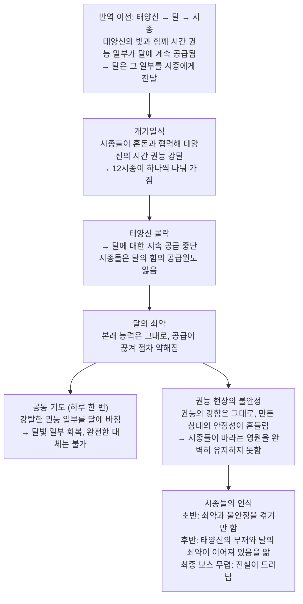

# 메인 스토리 기획서

> 프로젝트: 시간 테마 2D 쿼터뷰 실시간 액션 로그라이크  
> 목표: PC(Steam) 정식 출시 / 4장 × 3보스, 총 12보스  
> 문서 성격: 메인 스토리 기준 문서 (시종별 아카이브·개별 대사·세부 연출 제외)  
> 상태 구분: **[확정]** 승인된 설정 / **[제안]** 스토리 연결을 위한 초안 / **[미결]** 후속 결정 필요

## 1. 이야기의 핵심

**[확정]** 영원한 낮을 유지하던 태양신이 달의 열두 시종에게 배신당해 영원한 밤에 갇힌다. 태양신은 반복되는 밤 속에서 빼앗긴 시간 권능과 기억을 되찾으며 변화하고, 마지막에는 영원한 낮을 복원하는 대신 스스로 낮의 절반을 양보해 **12시간의 낮과 12시간의 밤**이 공존하는 질서를 선택한다.

**주제:** 영원에 대한 집착과 유한한 시간의 가치. 태양신과 시종들은 모두 '영원'을 추구했지만, 이야기의 결말은 어느 한쪽의 영원이 아니라 순환을 선택한다.

## 2. 주요 존재와 세계의 원리

### 2.1 태양신

- **[확정]** 과거에는 영원한 낮을 유지하는 존재였다.
- **[확정]** 시간의 질서를 유지하는 존재다. 시간을 창조하는 존재인지는 **[미결]**로 둔다.
- **[확정]** 역할에 충실했으며, 의도적으로 달을 억압하지 않았다.
- **[확정]** 자신이 맡은 역할을 다하는 신이었으며, 반역 이후 대부분의 시간 권능과 일부 기억을 잃었다.
- **[확정]** 게임 시작 시 자신의 정체, 권능을 빼앗겼다는 사실, 시종들이 적이라는 사실은 안다. 다만 반역의 구체적인 과정은 기억하지 못한다.
- **[확정]** 권능을 되찾는 여정에서 성장하여, 결말에는 낮과 밤을 12시간씩 나누는 새로운 질서를 스스로 선택한다.
- **[확정]** 분리할 수 없는 잔존 권능인 **순환**이 남아 있다.
- **[미결]** 태양신과 최종 시종의 과거 관계, 구체적인 성격과 대사.

### 2.2 달과 열두 시종

- **[확정]** 달은 태양신보다 수동적인 존재다. 스스로 시간 권능을 만들지 못한다(2.4).
- **[확정]** 열두 시종은 달을 섬기며, 영원과 불변을 최고의 가치로 여긴다. 달이 영원히 하늘에 드러나기를 바랐고, 태양신이 몰락하면 영원한 밤을 실현할 수 있다고 생각했다.
- **[확정]** 시종마다 영원을 추구하게 된 개인적인 이유는 다르게 설계한다. 상세 내용은 별도 아카이브 문서에서 다룬다.
- **[확정]** 개기일식에 혼돈과 협력해 혼돈의 쐐기로 태양신의 시간 권능을 12개로 분리·강탈하고, 나누어 가진다. 시종마다 하나의 강력한 시간 권능을 다룬다.
- **[확정]** 시종은 한 판에서 패배해 권능을 잃더라도 영구 소멸하지 않는다. 다음 순환에서 권능을 되찾고, 이전 대결을 기억한다.
- **[미결]** 개별 시종의 이름, 성격, 반역에서의 역할 및 태양신과의 구체적인 관계.

### 2.3 혼돈과 혼돈의 쐐기

- **[확정]** 혼돈은 기존 질서의 붕괴와 예측 불가능한 변화를 추구하여 반역에 협력했다. 혼돈과 시종들의 목적은 같지 않다.
- **[확정]** **혼돈의 쐐기**는 개기일식에 사용되어 태양신과 시간 권능의 연결을 끊었다. 그러나 태양신의 존재에 내재한 순환까지 분리하지는 못했다.
- **[확정]** 반역 이후 혼돈의 영역도 정체의 영향을 받는다. 일부 혼돈의 상인들은 혼돈 전체를 대표하지 않고, 자신의 이해관계 때문에 태양신을 돕는다.
- **[미결]** 혼돈의 쐐기의 현재 위치와 최종 결말에서의 처리 방식.

### 2.4 시간 권능의 공급과 달의 쇠약

**공급 관계**
- **[확정]** 달은 태양신의 빛을 받으며 시간 권능의 일부를 지속적으로 공급받았고, 그 일부를 시종들에게 전달할 수 있었다. 달이 독립적으로 시간 권능을 창조하지는 않는다.
- **[확정]** 태양신의 몰락으로 달에 대한 지속적인 권능 공급이 끊겼다. 달의 본래 능력은 변하지 않았지만, 공급이 끊겨 점차 쇠약해지고 있다.
- **[확정]** 시종들은 태양신을 몰락시켰지만, 그 결과 달의 힘의 공급원도 잃었다.

**공동 기도**
- **[확정]** 시종들은 하루에 한 번 공동 기도를 올려, 강탈한 시간 권능의 일부를 달에 바친다. 달은 이를 통해 달빛을 일부 회복한다.
- **[확정]** 기도의 힘은 신앙 자체에서 생기는 별도 에너지가 아니다. 바치는 것은 강탈한 시간 권능이다.
- **[확정]** 공동 기도만으로는 태양신이 공급하던 힘을 완전히 대체할 수 없다. 달은 장기적으로 쇠약해지고 있다.
- **[확정]** 시종들은 기도에 참여하더라도 각자의 시간 권능을 강력하게 행사할 수 있다.

**권능의 불안정성**
- **[확정]** 시종들의 권능 자체가 사라지지는 않는다. 달의 쇠약은 권능으로 만들어낸 현상의 안정성에 영향을 준다.
- **[확정]** 권능의 강함과 권능으로 만든 상태의 안정성은 구분한다. 시종들은 강력하지만, 자신들이 추구하는 영원을 완벽하게 유지하지 못할 수 있다.

**시종들의 인식**
- **[확정]** 초반부 시종들은 달의 쇠약과 권능의 불안정성을 경험한다. 이야기 후반부로 갈수록 태양신의 부재가 달의 쇠약과 연결되어 있음을 알게 되고, 최종 보스에 가까워질 무렵 이 진실이 드러나도록 구성한다.

**미결**
- **[미결]** 각 시종이 진실을 알게 되는 정확한 시점.
- **[미결]** 공동 기도의 시각·장소, 바치는 권능의 양, 달빛 감소량 등 수치(이 문서에서 확정하지 않음).
- **[미결]** 최종 시종과 달 사이의 구체적인 힘 전달 방식, 최종 시종이 공동 기도의 조율자인지(별도 승인 전 확정하지 않음).

## 3. 사건의 시간순 흐름

### 3.1 영원한 낮 — 반역 이전

**[확정]** 태양신은 시간의 질서를 유지하는 역할에 따라 영원한 낮을 유지한다. 달은 존재했지만 태양빛에 가려 희미하게 보였다. 시종들은 자신들이 섬기는 달이 영원히 하늘에 드러나기를 바란다. 시종들은 각기 다른 이유로 영원을 추구한다.

**[제안]** 태양신은 자신의 질서가 세계에 최선이라고 믿었지만, 그 질서에서 소외되는 존재들의 마음을 충분히 이해하지 못했다. 이는 태양신을 악인으로 만들기 위한 설정이 아니라, 결말에서 변화할 여지를 제공한다.

### 3.2 개기일식 — 태양신의 몰락

**[확정]** 달의 열두 시종은 혼돈의 협력을 얻는다. 개기일식에 혼돈의 쐐기를 사용해 태양신의 시간 권능을 12개로 분리·강탈한다. 태양신은 신성과 기억의 상당 부분을 잃고 몰락한다. 분리할 수 없는 잔존 권능인 순환은 남는다. 태양신의 몰락으로 달에 대한 권능 공급도 끊긴다(2.4).

**[미결]** 일식과 쐐기의 정확한 작동 관계 및 개별 시종의 반역 참여 장면.

### 3.3 영원한 밤 — 낮의 생략

**[확정]** 최종 시종은 핵심 권능 **시간 순서**로 밤 다음에 낮이 오는 순서를 끊는다. 세계의 시간은 18:00부터 다음 날 06시 직전까지 흐르고, 06시에 닿기 직전 그날 18:00으로 이어져 낮 12시간이 생략된다. 그래서 새 아침이 오지 않는다. 이는 시간을 되감는 것이 아니다. 날짜와 사건의 결과, NPC와 시종들의 기억은 이어진다.

예: 첫째 날 18:00 → 둘째 날 06시 직전 → 둘째 날 18:00 → 셋째 날 06시 직전.

### 3.4 반복되는 여정 — 태양신의 순환

**[확정]** 태양신은 18:00에 육체를 재구성해 새로운 판을 시작한다. 시종들을 쓰러뜨리며 임시 시간 권능과 잃어버린 기억을 되찾는다. 전투 중 사망하더라도 다음 순환에 다시 나타난다.

**[확정]** 판은 태양신이 사망할 때 끝난다(순환). 시간 권능은 시종들에게 반환되고, 태양신의 육체는 해체되었다가 다음 날 18:00에 서쪽 끝에서 재구성된다. 이미 회복한 기억과 영구 성장 요소는 유지된다. 06시 직전까지 살아남았는데 판이 끝나는 경우는 없다. 06시 직전에 닿는 것은 05시의 시종(11번째)을 처치했을 때뿐이다.

**[확정]** 달의 위상은 시간이 흐르고 있음을 보여주는 배경 연출이다. 밤이 진행될수록 **초승 → 상현 → 보름 → 하현 → 그믐** 순서로 변하며, 4장의 탄생·존재·쇠퇴·종언과 연결된다. 순환하면 18:00의 초승으로 돌아간다. 달의 위상과 달빛의 힘은 다른 개념이다. 보름달이라고 권능 공급량이나 달빛의 힘이 최대라는 뜻은 아니다. 각 위상이 시작되는 정확한 시각은 **[미결]**. 상세는 `WorldLevelStructure.md` 3절.

**[미결]** 사망 직후부터 06:00까지 임시 권능의 정확한 상태, 최종 승리 시 영구 귀속 처리의 세부 원리. 게임 규칙 문서에서 명시한다.

## 4. 4장 구성과 스토리 흐름

> **[확정]** 4장의 주제와 보스 시간·권능은 아래와 같다. 각 장에서 드러나는 구체적인 기억과 태양신의 감정 변화는 **[제안]**이며, 장별 연출 기획에서 확정한다.

| 장 | 주제 | 시간 | 시종의 시간 권능 |
|---|---|---|---|
| 1장 | 탄생 | 19:00 / 20:00 / 21:00 | 시간 축적 / 시간 유예 / 시간 역행 |
| 2장 | 존재 | 22:00 / 23:00 / 00:00 | 시간 감속 / 시간 공유 / 시간 정지 |
| 3장 | 쇠퇴 | 01:00 / 02:00 / 03:00 | 시간 침식 / 시간 갱신 / 시간 가속 |
| 4장 | 종언 | 04:00 / 05:00 / 06:00 | 시간 분기 / 시간 예지 / 시간 순서 |

**[확정]** 여정은 18:00에 시작하고 보스는 19:00부터 나온다. 첫 보스 방에 들어가면 19:00이 된다. 보스 순서와 권능은 이전과 같고 시각만 1시간씩 뒤로 옮겼다(2026-10-27, `WorldLevelStructure.md` 5절).

### 4.1 도입부 — 잃어버린 태양

**[확정]** 태양신은 자신의 정체와 권능을 빼앗긴 사실을 알고 깨어난다. 반역의 자세한 경위는 기억하지 못한다. 시종들을 쓰러뜨리고 시간 권능을 되찾기 위해 영원한 밤에 나선다.

### 4.2 1장: 탄생

**[제안]** 태양신은 첫 시종들과 싸우며 시간 권능을 회수할 수 있다는 사실을 체감한다. 초기 목표는 자신이 잃은 힘을 되찾는 것이다. 태양신의 본래 역할과 '새로운 시작'의 의미를 암시한다.

### 4.3 2장: 존재

**[제안]** 시종들이 단순히 권력을 탐낸 적이 아니라, 영원한 밤을 바랄 각자의 이유가 있었음을 이해하기 시작한다. 태양신과 시종들의 과거 관계에 대한 단서가 등장한다.

### 4.4 3장: 쇠퇴

**[제안]** 개기일식과 혼돈의 쐐기가 사용된 반역의 과정에 대한 기억이 복구된다. 태양신은 자신이 지키던 영원한 낮이 모두에게 완전한 질서가 아니었을 수 있음을 돌아본다.

### 4.5 4장: 종언

**[확정]** 마지막 시종은 시간 순서 권능으로 낮을 생략하는 핵심 존재다.

**[확정]** 04시의 시종 권능인 **시간 분기**는 여러 가능성 중 하나의 현실을 선택해 실현하는 힘이다. 선택되지 않은 현실을 완전히 제거하지는 못한다. 달의 쇠약은 이 현상의 불안정성을 악화시키는 원인으로 해석할 수 있지만, 시간 분기 권능 자체의 한계는 그대로 둔다. (2026-10-27. 확정 규칙의 '19시 지하수로 보스' 배치는 현재 시간표와 충돌해 반영하지 않음, 9절)

**[제안]** 태양신은 영원한 낮과 영원한 밤 모두를 되돌아보며, 이전의 질서로 단순 복귀하는 것 이외의 선택을 생각한다. 최종 시종과의 신념 대립이 절정에 이른다.

**[미결]** 최종 시종과 태양신의 특별한 관계. 관계의 성격과 구체적인 과거는 별도 설계한다.

### 4.6 결말 — 첫 일몰과 일출

**[확정]** 최종 시종을 처치하고 되찾은 시간 순서 권능을 발동하면, 낮을 생략하던 간섭이 해제된다. 태양신은 다시 영원한 낮을 유지할 수 있지만, 이를 선택하지 않는다. 자신의 의지로 낮 12시간과 밤 12시간을 나누어 태양과 달이 공존하는 새로운 질서를 만든다.

**[확정]** 05시의 시종을 처치하면 시계는 06시 직전에 멈추고, 최종 시종(06시)과는 그 상태로 싸운다. 최종 시종을 처치하면 시간 순서 권능을 회복하지만 시계는 06시 직전 그대로다. 플레이어가 동쪽 끝에서 직접 권능을 발동해 끊어진 순서를 복원하면 세계가 처음으로 06:00에 닿고, 이때 게임의 승리가 확정된다. 추가 생존은 요구하지 않는다. (2026-10-26, 2026-10-27 시각 갱신, `WorldLevelStructure.md` 10절)

**[제안]** 결말의 핵심 정서는 '빼앗긴 것을 모두 되찾음'보다 '되찾은 힘을 과거와 다르게 사용함'에 둔다.

## 5. 최종 시종 — 전투와 서사의 접점

- **[확정]** 권능은 **시간 순서**다. 이전에 논의했던 '인과 역전'은 현재 최종 권능이 아니다.
- **[확정]** 다른 시종들의 시간 권능도 제한적으로 활용할 수 있다. 활용 방식은 아래 체력 구간 규칙을 따른다.
- **[확정]** 체력 100~75%: 1장 계열 권능 활용 / 75~50%: 2장 / 50~25%: 3장 / 25~0%: 4장.
- **[확정]** 25% 이하에서는 **세 공격의 순서만 재배열**하는 패턴을 사용한다. 지나치게 복잡한 순서 조작은 하지 않는다.
- **[미결]** 태양신과의 특별한 과거 관계, 최종 시종의 구체적인 동기, 체력 0 이후 최후 저항의 상세 규칙.
- **[미결]** 달과의 구체적인 힘 전달 방식. 공동 기도의 조율자 역할은 별도 승인 전 확정하지 않는다.

## 6. 스토리 전달 원칙

- **[확정]** 메인 스토리는 한 판의 진행과 4장 보스 전투에 연결한다.
- **[확정]** 시종별 개인사와 영원을 추구한 이유는 별도의 **아카이브 문서**에서 설계한다. 암두아트의 12시간 구조와 존재들을 참고하되, 시각 디자인은 이집트 양식을 그대로 모방하지 않고 중세 다크 판타지 방향을 유지한다.
- **[제안]** 메인 스토리 이해에 필수적인 사실은 아카이브를 모두 모으지 않아도 알 수 있게 한다. 아카이브는 인물 해석과 배경을 깊게 만드는 보조 자료로 사용한다.
- **[제안]** 기억 회복은 장별 핵심 사건에 집중해 연출 부담을 줄인다. 정확한 해금 시점은 미결이다.

## 7. 후속 문서로 분리할 내용

1. **시종별 아카이브** — 암두아트 모티브, 개인사, 영원을 추구한 이유, 수집품 내용.
2. **최종 시종 관계성** — 태양신과의 과거, 신념의 대립, 반역에서의 역할.
3. **장별 연출·대사** — 기억 회복 장면, 보스 전후 대화, 엔딩 연출.
4. **순환 및 권능 규칙 명세** — 사망 처리, 06:00 경계, 권능 반환·영구 귀속의 정확한 판정.
5. **게임 콘텐츠 명세** — 전투 수치, 보상·성장, UI, Inspector 조절 항목, 스테이지 흐름.

## 8. 변경 시 주의사항

- 이전의 '태양신은 원래 정상적인 낮밤 순환을 유지했다'는 설정은 **폐기**한다. 과거는 **영원한 낮**이다.
- 최종 목표는 원래의 영원한 낮 복원이 아니라 **12시간 낮 / 12시간 밤의 새 질서**다.
- 낮 생략은 시간 역행이 아니다. 사건과 기억은 초기화되지 않는다.
- 한 판의 임시 권능은 초기화되지만 기억과 영구 성장은 유지된다.
- 아카이브의 세부 내용을 메인 스토리의 확정 사실처럼 선반영하지 않는다.
- 달의 위상은 달빛의 힘을 나타내지 않는다. 위상으로 권능의 세기를 설명하지 않는다.
- 공동 기도는 신앙 에너지가 아니라 강탈한 시간 권능을 바치는 행위다.

## 9. 변경 이력

| 날짜 | 항목 | 기존 설정 | 변경된 설정 |
|---|---|---|---|
| 2026-10-27 | 보스 시각 | 18시~05시, 첫 보스 = 18시 축적 | 19시~06시, 첫 보스 = 19시 축적. 보스 순서·권능은 그대로 (4절) |
| 2026-10-27 | 18:00 → 19:00 전환 | 없음 (첫 보스를 18:00에 싸움) | 18:00 시작, 첫 보스 방 입장 시 19:00 |
| 2026-10-27 | 06시 직전 멈춤 | 최종 시종(05시) 처치 후 | 05시 시종(11번째) 처치 후. 최종 시종(06시)은 06시 직전 상태로 싸움 (4.6) |
| 2026-10-27 | 달의 위상 | 삭 → 망 → 삭, 순환 시 18:00의 삭 | 초승 → 상현 → 보름 → 하현 → 그믐, 순환 시 18:00의 초승. 위상 ≠ 달빛의 힘 (3.4) |
| 2026-10-27 | 권능 공급 구조 | 없음 | 태양신 → 달 → 시종 공급, 몰락 후 공급 중단·달의 쇠약, 공동 기도, 권능의 불안정성, 시종의 인식 (2.4 신설) |
| 2026-10-27 | 태양신의 역할 | 영원한 낮을 유지하는 존재 | 시간의 질서를 유지하는 존재(시간 창조 여부 미결), 달을 의도적으로 억압하지 않음, 달은 태양빛에 가려 희미했음 (2.1, 3.1) |
| 2026-10-27 | 시종의 동기 | 영원한 것을 높은 가치로, 달이 드러날 시간을 원함 | 영원과 불변을 최고 가치로, 달이 영원히 드러나기를 원함, 혼돈과 목적이 다름 (2.2, 2.3) |
| 2026-10-27 | 시간 분기 | 03시 권능 이름만 | 04시. 현실 하나를 선택·실현, 선택되지 않은 현실은 남음, 달의 쇠약은 불안정 악화 요인 (4.5) |
| 2026-10-27 | 순환 재시작 | 다음 18:00 | 다음 날 18:00 (3.4) |
| 2026-10-27 | 최종 시종 | 체력 구간별 권능 | 다른 시종 권능을 제한적으로 활용(체력 구간 규칙 유지), 달과의 힘 전달·기도 조율자는 미결 (5절) |

**반영하지 못한 확정 규칙**: '19시 지하수로 보스 = 시간 분기'. 현재 시간표에서 19시는 시간 축적이고 시간 분기는 04시다. 지하수로 지역 설정은 이 문서에 없다. 결정 전까지 4.5에 권능의 성질만 반영한다.
