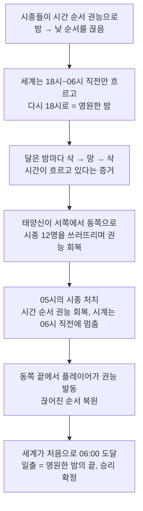
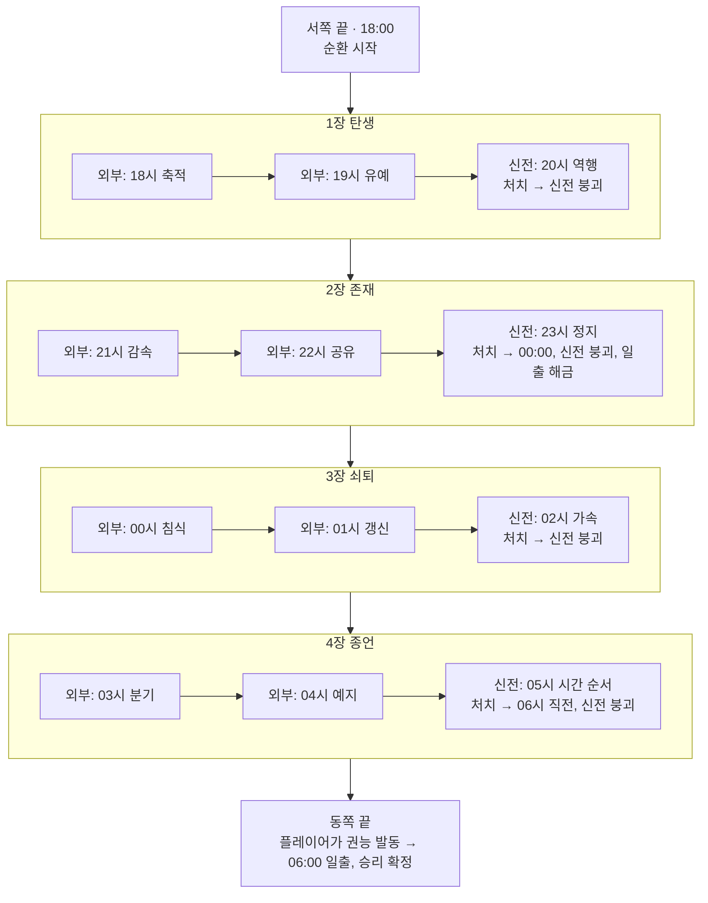
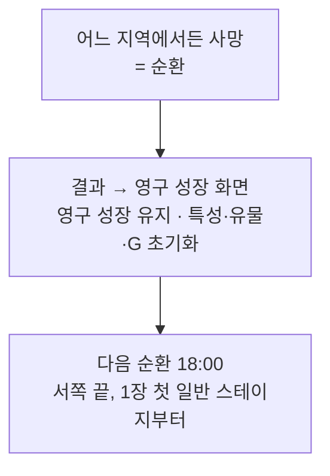

# 세계 공간 구조와 시간 진행

> 상위 문서: `Docs/Design/GameDesign.md`(2·3·16절), `Docs/Design/MainStory.md`(3·4절)
> 관련 문서: `Docs/Design/Amduat_Boss_Mapping.md`(보스 권능·신화 대응), `Docs/SliceA/VerticalSliceA.md`(1장 진행 흐름), `Docs/SliceA/NormalRoom.md`(일반 방)
> 이 문서가 다루는 것: 영원한 밤의 원리, 달의 위상, 게임 속 시각이 넘어가는 규칙, 여정의 방향, 지역과 달의 대신전, 보스 위치와 진행 조건. 보스 패턴과 수치는 상위 문서를 따른다.
> 표기: **[확정]** 사용자 확정 / **[제안]** 초안 / **[미결]** 결정 필요
> 작성: 2026-10-26 / 개정: 2026-10-26 시간 순환·달 위상 반영

---

## 1. 기획 목적과 핵심 콘셉트

**[확정]** 게임은 2D 탑다운 기반 쿼터뷰 실시간 액션 로그라이크다. 이 문서는 한 판이 어디서 시작해 어디서 끝나는지, 그 사이에 시간이 어떻게 흐르는지를 정한다.

**[확정]** 핵심 콘셉트: 세계는 아침이 오지 않는 밤을 되풀이한다. 태양신은 해가 지는 서쪽에서 출발해 시종들에게서 권능을 되찾으며 동쪽으로 걷고, 동쪽 끝에서 끊어진 순서를 이어 처음으로 아침을 맞게 한다.

**[확정]** 처음 만드는 게임이므로 직선형 진행으로 단순하게 유지한다. 지역 간 분기와 자유 탐험은 두지 않는다.

---

## 2. 세계의 시간 순환 원리 (세계관)

- **[확정]** 달의 시종들은 시간 전체를 멈춘 것이 아니다. 끊어낸 것은 **밤이 끝나고 낮이 시작되는 순서**다.
- **[확정]** 세계의 시간은 18시부터 다음 날 06시 직전까지 흐른다. 06시에 닿기 직전 세계는 다시 18시로 돌아간다. 이것이 되풀이되어 새 아침이 오지 않는다. 이 현상이 시종들이 만든 **영원한 밤**이다.
- **[확정]** 이 반복은 되감기가 아니다. 날짜, 사건의 결과, NPC와 시종의 기억은 이어진다(`MainStory.md` 3.3절).
- 이유: 시간이 멈춘 세계가 아니라 흐르는데도 아침만 오지 않는 세계로 두어야, 시간 권능 전투와 시각 변화 연출이 성립한다.

---

## 3. 달의 위상

- **[확정]** 달의 위상 변화는 시간이 흐르고 있다는 것을 눈으로 보여준다.
- **[확정]** 밤이 진행되면 달은 삭 → 망 → 삭 순서로 변한다. 이 변화는 4장의 탄생 → 존재 → 쇠퇴 → 종언 구조와 연결된다.
- **[확정]** 달의 위상과 위치는 시간대별 배경 연출에 쓴다. 실제 천문학의 약 29.5일 삭망 주기는 구현하지 않는다. 게임 세계의 비정상적인 시간 순환을 보여주는 판타지 연출이다.
- **[확정]** 플레이어가 조작하는 시스템이 아니다.

| 장 | 주제 | 달의 위상 변화 | 상태 |
|---|---|---|---|
| 1장 | 탄생 | 삭 → 상현 | [제안] |
| 2장 | 존재 | 상현 → 망 (자정에 보름달) | [제안] |
| 3장 | 쇠퇴 | 망 → 하현 | [제안] |
| 4장 | 종언 | 하현 → 삭 | [제안] |

- 이유: 달이 차오르고 이우는 모습이 장 주제(태어나고, 가득 차고, 기울고, 사라짐)와 그대로 겹친다. 자정 보스 처치(6번째)에 보름달이 뜨면 밤의 절반을 넘었다는 걸 설명 없이 알 수 있다.
- 시각별 정확한 위상과 달의 위치·이동 속도: **[미결]**

---

## 4. 서쪽에서 동쪽으로 향하는 여정

| 위치 | 의미 | 시각 | 상태 |
|---|---|---|---|
| 서쪽 끝 | 태양이 지는 곳, 여정의 시작점. 순환마다 여기서 다시 시작 | 18:00 | [확정] |
| 1~4장 지역 | 서쪽에서 동쪽 순서로 이어진 4개 지역 | 18:00~06시 직전 | [확정] |
| 동쪽 끝 | 태양이 떠오르는 곳, 여정의 목적지 | 06시 직전 → 06:00 | [확정] |

- **[확정]** 태양신은 시종을 쓰러뜨려 권능을 회복하면서 동쪽으로 이동한다.
- **[확정]** 왕국 같은 정치적 공간 설정은 필수 요소로 두지 않는다.
- 이유: 해가 지는 쪽에서 뜨는 쪽으로 걷는 방향이 곧 밤이 지나가는 방향이라, 지도가 없어도 얼마나 남았는지 알 수 있다.

---

## 5. 게임플레이 시간 진행

- **[확정]** 한 판은 18:00에 시작한다.
- **[확정]** 게임 속 시각은 현실 플레이 시간으로 자동으로 늘지 않는다. **보스 스테이지를 클리어할 때** 다음 시간 구간으로 넘어간다. 일반 스테이지는 시각을 바꾸지 않는다(`VerticalSliceA.md` 4절).
- **[확정]** 시간 구간은 18시~05시의 12개이고, 구간마다 시종 보스가 한 명씩 있다. 보스는 자기 구간으로 부른다. 예: 첫 보스 = 18시의 시종, 마지막 보스 = 05시의 시종.
- **[확정]** 시계는 보스를 처치할 때 다음 시각으로 넘어간다. 예외로 05시의 시종을 처치하면 시계는 **06시 직전에 멈춘다**. 06:00은 플레이어가 권능을 발동해야 온다(10절).
- **[확정]** 최종 보스와 싸우는 동안 현실 시간이 흘러도 06시가 되지 않는다. 전체 플레이 시간제한과 시간 초과로 인한 강제 순환은 두지 않는다.
- 이유: 시각을 플레이어의 성과(보스 처치)에만 묶어야 시계가 진행도가 되고, 시간에 쫓기는 압박 없이 보스전에 집중할 수 있다.

### 5-1. 18시 → 06시 전체 진행

| 구간 | 장 | 시종 권능 | 위치 | 처치 후 시계 |
|---|---|---|---|---|
| 18시 | 1장 탄생 | 시간 축적 | 신전 외부 | 19:00 |
| 19시 | 1장 탄생 | 시간 유예 | 신전 외부 | 20:00 |
| 20시 | 1장 탄생 | **시간 역행** (핵심) | 1장 신전 내부 | 21:00 |
| 21시 | 2장 존재 | 시간 감속 | 신전 외부 | 22:00 |
| 22시 | 2장 존재 | 시간 공유 | 신전 외부 | 23:00 |
| 23시 | 2장 존재 | **시간 정지** (핵심) | 2장 신전 내부 | 00:00 (자정, 일출 해금) |
| 00시 | 3장 쇠퇴 | 시간 침식 | 신전 외부 | 01:00 |
| 01시 | 3장 쇠퇴 | 시간 갱신 | 신전 외부 | 02:00 |
| 02시 | 3장 쇠퇴 | **시간 가속** (핵심) | 3장 신전 내부 | 03:00 |
| 03시 | 4장 종언 | 시간 분기 | 신전 외부 | 04:00 |
| 04시 | 4장 종언 | 시간 예지 | 신전 외부 | 05:00 |
| 05시 | 4장 종언 | **시간 순서** (최종) | 4장 신전 내부 | 06시 직전 (멈춤) |
| — | 동쪽 끝 | 플레이어가 권능 발동 | 동쪽 끝 | **06:00 일출** |

- 구간 이름과 권능 배정은 `MainStory.md` 4절, `Amduat_Boss_Mapping.md` 2절 표와 같다. 암두아트 제N시간 = N번째 구간이다.
- 자정 보스는 23시의 시종(6번째)이다. 처치하면 시계가 00:00이 되고 일출이 해금된다(`GameDesign.md` 16-2).
- 화면에서 "06시 직전"을 어떻게 표시할지(05:59, 바늘이 06 직전에서 떨림 등): **[미결]**

### 5-2. 세계관의 반복과 게임플레이 진행 구분

| 항목 | 세계관 (영원한 밤) | 게임플레이 |
|---|---|---|
| 시간이 흐르는 방식 | 18시부터 06시 직전까지 계속 흐름 | 보스 처치 때만 1시간씩 넘어감 |
| 18시로 돌아가는 계기 | 06시 직전에 닿을 때마다 | 플레이어 사망(순환) |
| 06시 직전에 닿는 경우 | 매일 밤 | 05시의 시종을 처치했을 때뿐 |
| 06:00에 닿는 경우 | 없음 | 플레이어가 동쪽 끝에서 권능을 발동했을 때 |

- **[확정]** 플레이어가 06시 직전까지 살아남았는데 권능을 회복하지 못해 판이 끝나는 상황은 게임플레이에 만들지 않는다.
- 이유: 세계가 반복되는 이유는 이야기로만 설명하고, 플레이어가 판을 다시 하는 이유는 오직 사망으로 둔다. 두 규칙이 섞이면 "시간이 다 돼서 졌다"는 오해가 생긴다.

---

## 6. 지역 및 달의 대신전 구조

- **[확정]** 장마다 서로 다른 지역이 배경이다. 지역은 4개, 달의 대신전도 지역마다 하나씩 총 4개다.
- **[확정]** 지역 하나는 **신전 외부**와 **신전 내부**로 나뉜다. 외부에 시종 2명, 내부에 시종 1명이 있다.
- **[확정]** 대신전은 정상적인 시간 흐름만으로는 지금 모습을 유지할 수 없는 건축물이다. 그 지역 시종 3명의 시간 권능으로 유지된다. 신전 밖에 있는 시종도 권능을 보탠다.
- **[확정]** 지역마다 환경과 분위기가 달라야 하고, 잡몹·맵·보스 아트는 그 장의 주제와 시간 권능과 시각적으로 이어져야 한다.
- 이유: 신전을 시종들의 권능으로 버티는 건물로 두면, 권능을 되찾는 일과 신전이 무너지는 일이 하나로 이어진다.
- 신전의 이름과 건축 양식, 지역별 지형과 맵 배치: **[미결]**

---

## 7. 챕터별 보스 배치와 진행 조건

**[확정]** 장마다 외부 시종 2명 → 대신전 안 핵심 권능 시종 1명 순서로 진행한다. 권능 배정은 `MainStory.md` 4절과 `Amduat_Boss_Mapping.md` 1절의 확정 사항을 따른다.

| 장 | 외부 시종 (순서대로) | 신전 진입 조건 | 신전 내부 핵심 시종 | 다음 장 진입 조건 |
|---|---|---|---|---|
| 1장 탄생 | 18시 축적 → 19시 유예 | 외부 2명 처치 | 20시 역행 | 1장 신전 붕괴 |
| 2장 존재 | 21시 감속 → 22시 공유 | 외부 2명 처치 | 23시 정지 | 2장 신전 붕괴 |
| 3장 쇠퇴 | 00시 침식 → 01시 갱신 | 외부 2명 처치 | 02시 가속 | 3장 신전 붕괴 |
| 4장 종언 | 03시 분기 → 04시 예지 | 외부 2명 처치 | 05시 시간 순서 | 4장 신전 붕괴 → 동쪽 끝 |

- **[확정]** 보스 하나마다 일반 스테이지 2개를 지난 뒤 보스 스테이지가 나온다(`GameDesign.md` 3절). 일반 방 구성은 `NormalRoom.md`를 따른다.
- **[확정]** 외부 시종 2명을 순서대로 처치해야 신전에 들어갈 수 있다.
- 이유: 신전 문이 열리는 순간과 무너지는 순간이 장의 중간과 끝을 화면으로 알려준다.
- 3번째 보스 앞 일반 스테이지 2개가 신전 밖인지 안인지: **[미결]**

각 보스 노드 앞에는 일반 스테이지 2개가 있다(그림에서는 생략).

---

## 8. 권능 회복과 신전 붕괴

- **[확정]** 태양신이 시종을 쓰러뜨려 권능을 회복할수록 신전을 유지하는 힘이 사라진다.
- **[확정]** 핵심 권능 시종을 처치하면 신전이 완전히 무너진다. 신전 붕괴는 그 장이 끝났다는 표시다.
- **[확정]** 신전이 무너진 뒤 플레이어는 다음 지역(동쪽)으로 이동한다.
- 외부 시종을 처치할 때 신전에 눈에 보이는 변화가 생기는지: **[미결]**
- 붕괴 연출의 길이와 플레이어 조작 여부: **[미결]**

---

## 9. 플레이어 사망과 순환

- **[확정]** 사망하면 순환이 일어나고, 태양신은 다시 서쪽 끝 18:00에서 시작한다.
- **[확정]** 영구 성장은 유지되고 한 판에서 얻은 임시 강화는 초기화된다. 유지·초기화 항목은 `GameDesign.md` 2절과 `VerticalSliceA.md` 10절을 따른다.
- **[확정]** 세계의 밤이 반복되는 현상(2절)과 태양신의 죽음·재시작은 세계관에서 연결된다. 게임플레이에서 순환을 일으키는 것은 사망 하나뿐이다(5-2).
- **[확정]** 로그라이크의 반복 변화는 지역 구조가 아니라 전투, 보상, 빌드, 스테이지 내부 구성(무작위 방 형태 등)에서 만든다.
- 이유: 죽어도 18시로 돌아오는 태양신과 아침 직전에 18시로 돌아가는 세계를 같은 현상으로 엮으면, 재시작이 게임 장치가 아니라 이야기의 일부가 된다.
- 두 반복을 세계관에서 어떻게 연결해 설명할지(같은 현상인지, 태양신만의 순환인지): **[미결]**
- 다시 시작할 때 무너진 신전을 다시 서 있는 것으로 보여줄지: **[미결]**

---

## 10. 최종 권능과 일출

- **[확정]** 마지막 시종(05시)은 **시간 순서** 권능을 쓴다. 밤 다음에 낮이 오는 순서를 되살리려면 이 권능이 필요하다.
- **[확정]** 05시의 시종을 처치하면 시간 순서 권능을 회복하고, 시계는 06시 직전에 멈춘다.
- **[확정]** 태양신은 동쪽 끝에서 **플레이어가 직접** 회복한 권능을 발동해 끊어진 순환을 복원한다. 세계는 처음으로 실제 06:00에 닿고 태양이 떠오른다.
- **[확정]** 게임 승리는 05시의 시종을 처치한 순간이 아니라 플레이어가 권능을 발동한 뒤에 확정된다.
- **[확정]** 일출은 영원한 밤의 끝이자 새 하루의 시작이다.
- 이유: 되찾은 권능을 스스로 돌려놓는 행동이 결말의 선택(`MainStory.md` 4.6, 영원한 낮 대신 낮과 밤의 공존)을 플레이로 보여준다.
- 권능 발동이 어떤 조작인지, 일출 능력(`GameDesign.md` 11절)과 같은 것인지: **[미결]**
- 일출 연출 상세: 이 문서에서 다루지 않는다.

---

## 11. 시험판 및 본편 제작 범위

| 단계 | 범위 | 상태 |
|---|---|---|
| 시험판 | 1장(서쪽 끝 → 18시·19시 외부 시종 → 1장 신전 20시 역행 → 신전 붕괴)을 먼저 완성하고 검증 | [확정] |
| 확장 | 검증 뒤 2~4장 지역과 신전 추가 | [확정] |
| 최종 목표 | PC Steam 완성작 출시 | [확정] |

- 시험판 1장의 처치 후 시계(19:00 / 20:00 / 21:00)는 `VerticalSliceA.md` 4절 표와 같다.
- 시험판에서 신전 외부와 내부를 시각적으로 구분할지, 신전 붕괴와 달 위상 연출을 넣을지: **[미결]**

---

## 12. 확정 / 제안 / 미결 사항

### 12-1. 확정
- 영원한 밤 = 밤 → 낮 순서가 끊겨 18시~06시 직전이 반복되는 현상. 되감기가 아님
- 달은 밤마다 삭 → 망 → 삭, 배경 연출 전용
- 시각은 보스 처치 때만 넘어감. 현실 시간 자동 진행·시간제한 없음
- 보스는 18시~05시 구간으로 부름. 처치 후 시계는 다음 시각, 05시 처치 후는 06시 직전에 멈춤
- 서쪽 끝(18:00) → 동쪽 끝의 직선형 여정, 4장 = 4지역 = 4신전, 장마다 외부 2 + 신전 1
- 외부 2명 처치 → 신전 진입, 핵심 시종 처치 → 신전 붕괴 → 다음 지역
- 사망 = 순환, 서쪽 끝 18:00 재시작. 게임플레이에서 순환의 계기는 사망뿐
- 05시 처치 → 동쪽 끝에서 플레이어가 권능 발동 → 06:00 일출 → 승리 확정
- 시점 표기: "2D 탑다운 기반 쿼터뷰"

### 12-2. 제안
- 장별 달 위상 배분: 1장 삭→상현, 2장 상현→망, 3장 망→하현, 4장 하현→삭 (3절)

### 12-3. 미결
1. 시각별 정확한 달 위상, 달의 위치·이동 속도
2. "06시 직전"의 화면 표시 방식
3. 동쪽 끝 권능 발동의 조작 방식, 일출 능력과의 관계
4. 세계의 반복과 태양신 순환을 세계관에서 연결하는 방식
5. 신전 안 마지막 보스 앞 일반 스테이지 2개의 위치(신전 밖 / 안)
6. 외부 시종 처치 시 신전의 변화 표시, 붕괴 연출의 길이·조작 여부
7. 재시작 시 무너진 신전의 표현
8. 신전 이름·건축 양식, 지역별 지형·맵 배치
9. 시험판에서 신전 구분·붕괴·달 위상 연출 포함 여부

### 12-4. 기존 문서와 충돌하는 항목

| 항목 | 이 문서 | 기존 문서 | 처리 |
|---|---|---|---|
| 마지막 처치 후 시각 | 05시 처치 → 06시 직전에 멈춤, 06:00은 권능 발동 뒤 | `MainStory.md` 4.6절 "최종 시종을 처치하면 06:00이 되고", `GameDesign.md` 16-4절 "06:00 도달(12번째 보스 처치) →" | 수정 완료 (2026-10-26) |
| 영원한 밤의 경계 | 06시 직전에 18시로 돌아감, 06시에 닿지 않음 | `MainStory.md` 3.3절 "06:00 다음을 같은 날 18:00에 연결", 예시 "둘째 날 06:00" | 수정 완료 (2026-10-26) |
| 06시에 판 종료 | 게임플레이에서 순환은 사망뿐. 06시 직전 생존 실패 상황 없음 | `MainStory.md` 3.4절 "06:00에는 생존 여부와 관계없이 해당 판이 종료" | 수정 완료 (2026-10-26): 판 종료는 사망으로만 |
| 달의 위상 | 밤마다 삭 → 망 → 삭, 시간 흐름 표시 | `MainStory.md` 3.4절 "권능을 회수할수록 삭에서 보름달 방향, 다음 순환에 삭" | 수정 완료 (2026-10-26): 시간 흐름 표시, 삭→망→삭 |
| 시점 표기 | 2D 탑다운 기반 쿼터뷰 | `MainStory.md` 머리말 "쿼터뷰", `ArtSpecification.md` 1-1 "2D 탑다운(3/4 내려다보기)" | 용어만 다름. 수정 여부 결정 필요 |

- 이전 판에 있던 "보스 시각 표기" 충돌은 이번에 구간 표기(18시~05시)로 정하면서 `MainStory.md` 4절·`Amduat_Boss_Mapping.md` 2절과 맞아 해소됐다.
